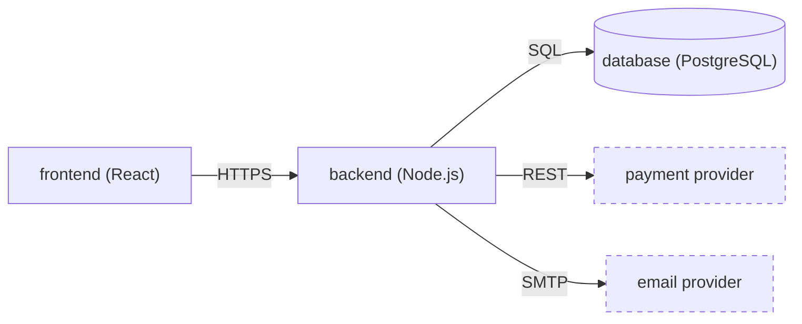

# Architecture Requirements

These requirements define the architecture document: where it lives, the container view and its responsibilities, the diagram conventions, the drivers it links, the ADR index that maps each record to the requirements it answers, and what makes a requirement architecturally significant.
The record an index row points at is specified in [Architectural Decision Record Requirements](adr-requirements.md), the requirements the index names are in [Functional Requirements](functional-requirements-requirements.md) and [Quality Requirements](quality-requirements-requirements.md), and the scope the document serves stays in [Product Vision Requirements](product-vision-requirements.md).
How the `ADR-nnn`, `FR-nnn`, and `QR-nn` identifiers are issued and cited is in [General Requirements](general-requirements.md#identifier-rules).
[Guide: Quality And Architecture](../guides/quality-and-architecture.md) is the method.

<h2>Table of contents</h2>

- [Where The Architecture Lives](#where-the-architecture-lives)
- [Drivers](#drivers)
- [Container View](#container-view)
- [Container Responsibilities](#container-responsibilities)
- [Diagrams And Legends](#diagrams-and-legends)
- [Architecturally Significant Requirements](#architecturally-significant-requirements)
- [Architectural Decisions](#architectural-decisions)
- [Full Example](#full-example)

## Where The Architecture Lives

**Since: W4**

The architecture document records what the software system is made of, and it points at the requirements that shaped that structure instead of restating them.

**Required**

1. `docs/architecture/README.md` is the only architecture document, and it is created in Week 4 in its final place.
   It is maintained documentation and stays current, per [Where Artifacts Live In The Repository](general-requirements.md#where-artifacts-live-in-the-repository).
2. It opens with one sentence that links `docs/product-vision.md` as the scope it serves, and then carries these parts, in this order:

   - `## Drivers`, per [Drivers](#drivers): the four groups of requirements that drive the architecture.
   - `## Container View`, per [Container View](#container-view): the applications and data stores the product runs as, with `### Container Responsibilities` beneath it, per [Container Responsibilities](#container-responsibilities).
   - `## Diagrams And Legends`, per [Diagrams And Legends](#diagrams-and-legends): the legend and the conventions every diagram in the document follows.
   - `## Architectural Decisions`, per [Architectural Decisions](#architectural-decisions): the ADR index.

3. It carries no trace section, because the chain from a story to the threshold of success is the links between the artifacts and no document restates it, per [Traceability Into Later Weeks](general-requirements.md#traceability-into-later-weeks).
4. Week 5 adds `## Component View` and `## Sequence View` between `## Container View` and `## Diagrams And Legends`, so the final order is drivers, container, component, sequence, diagrams, and decisions.
   [The Assignment 5 plan](../course/plans/a5-plan.md) says what those two views and their sources are.
5. The goal, stakeholders, boundary, constraints, and system context stay in `docs/product-vision.md`, and the context diagram stays embedded there.
   Week 4 moves no section, so a link to `docs/product-vision.md#constraints`, `#boundary`, or `#system-context` keeps resolving.
6. The vision links `docs/architecture/README.md` as a whole, per [Where The Vision Lives](product-vision-requirements.md#where-the-vision-lives), so the two documents point at each other and neither copies the other.

**Recommended**

- Keep the opening sentence to the scope alone, so a reader who stops after it knows what the document is for and meets the drivers immediately after.

## Drivers

**Since: W4**

An **architectural driver** is a requirement or a goal that shapes the architecture: a business goal the product serves, a constraint it lives inside, behavior it must deliver, or quality it must meet.
`## Drivers` says where each group of them lives and links it, so the section names no item of its own.

**Required**

1. `## Drivers` carries four entries, in this order, as a bulleted list rather than a table, and each entry links the holder of its group:

   - The **business goals** link `docs/threshold-of-success.md` in full, because a goal is its own `## TOS-nn` section and the threshold owns the statement, per [The Threshold Of Success](planning-requirements.md#the-threshold-of-success).
   - The **constraints** link `docs/product-vision.md#constraints`, whose `### CON-nn` sections are the constraints, per [Constraints](product-vision-requirements.md#constraints).
   - The **functional requirements** link `docs/functional-requirements/README.md`, the group's index, per [The Functional Requirements Index](functional-requirements-requirements.md#the-functional-requirements-index).
   - The **quality requirements** link `docs/quality-requirements/README.md`, which is the group's index and the priority matrix, per [The Quality Requirements Index](quality-requirements-requirements.md#the-quality-requirements-index).

2. The section names no `TOS-nn`, `CON-nn`, `FR-nnn`, or `QR-nn`, and it restates no goal, constraint, or requirement: an entry says which group it is and links the group.
3. The section is not a table, because the ADR index's `Addresses` column is the one table that maps a requirement to the record that answers it, per [Architectural Decisions](#architectural-decisions).
4. The boundary and the system context are scope rather than drivers, so the section links neither of them, and the opening sentence links the vision for both.
5. A requirement that no record answers yet is still reached through the index its group owns, so nothing dangles from the drivers section.

**Recommended**

- Write one line per entry, so the section stays a map of where the drivers live rather than an argument about them.

**Example**

The four entries in `docs/architecture/README.md` of the meeting-booking example:

```markdown
- **Business goals:** [the threshold of success](../threshold-of-success.md) holds the goals the architecture serves.
- **Constraints:** the product vision's [constraints section](../product-vision.md#constraints) holds the conditions the architecture lives inside.
- **Functional requirements:** the [functional requirements index](../functional-requirements/README.md) holds the behavior the architecture must deliver.
- **Quality requirements:** the [quality requirements index](../quality-requirements/README.md) holds the quality the architecture must meet, and it is also the priority matrix.
```

## Container View

**Since: W4**

The **container view** is the picture of what the product is made of: its **containers**, the applications and data stores it runs as, their technology, and the external systems they exchange data with.
A **container** is C4's abstraction: an application or a data store that has to be running for the product to work.
[https://c4model.com/abstractions/container](https://c4model.com/abstractions/container) defines it as a runtime boundary rather than a Docker container.
A JAR, a DLL, or a module organises the code inside a container rather than being one.
It is the first view of the product's own structure, and the component and sequence views Week 5 adds build on it.

**Required**

1. `## Container View` opens with one sentence that links the record that decides the stack and the container split, per [The Record](adr-requirements.md#the-record), such as "the product runs as the containers below, and `ADR-005` decides that split and the stack it runs on".
2. Below the sentence, the diagram is embedded as an image, per [Diagrams And Legends](#diagrams-and-legends).
3. The diagram shows every container and every external system a container exchanges data with, and no external actor, which the vision's [System Context](product-vision-requirements.md#system-context) already shows.
4. The diagram shows at least two containers, each one an application or a data store the team deploys or rents, such as a web frontend, a backend service, or a database.
   A product that genuinely runs as one container says so in the section's opening sentence, in place of the count.
5. Each container's label names the container and its technology, such as `backend (Node.js)`.
6. The diagram shows exactly the rows of [Container Responsibilities](#container-responsibilities), with the same names and the same spelling.
7. The section is a view and not a decision: the reason for the split and the stack stays in the record it links, per [What It Accounts For](adr-requirements.md#what-it-accounts-for).

**Recommended**

- Draw the containers in the order a request travels, from the container the customer uses to the store it reaches.
- Keep one box per container the team can point at in its hosting, its `compose` file, or its deployment README, rather than one box per module it plans.

**Example**

The opening sentence and the diagram embed, with the source committed beside it:

```markdown
The product runs as the containers below, and [`ADR-005`](adr/ADR-005.md) decides that split and the stack it runs on.


```

## Container Responsibilities

**Since: W4**

`### Container Responsibilities` is the maintained list of the containers and what each one does.
It sits under `## Container View`, so the picture and the table are read together and cannot drift.

**Required**

1. The section holds one table, with these columns in this order:

   | Column             | What it holds                                                                                                                                         |
   | ------------------ | ----------------------------------------------------------------------------------------------------------------------------------------------------- |
   | `Container`        | The container's name in code style, such as `backend`, spelled as the diagram spells it                                                               |
   | `Responsibilities` | Two to five responsibilities in one sentence, each clause starting with a verb and separated by a semicolon, so a reader scans one line per container |

2. The table has one row per container in the diagram, in the diagram's order, and names the same containers with the same spelling.
3. Each `Responsibilities` cell gives two to five responsibilities, and at least one says what data or state the container owns.
4. A responsibility names no library, framework version, or vendor product: the stack and its reasons belong to the record the view links.
5. Every container is named by at least one functional requirement's `**Containers:**` field or is a store those requirements use, per [The Functional Requirement](functional-requirements-requirements.md#the-functional-requirement).
   A container that is neither is not part of the product yet.
6. The table is the maintained list of the set: a container added, renamed, or removed changes the table, the diagram, and the record that decides it, in one change, per [The Record](adr-requirements.md#the-record).

**Recommended**

- Group the rows in the order a request travels, so the table reads as the same story as the diagram.
- Keep each responsibility to what someone placing a change needs to know, rather than to every feature the container has.

**Example**

The responsibilities of the containers in the [full example](#full-example):

```markdown
| Container  | Responsibilities                                                                                                                                          |
| ---------- | --------------------------------------------------------------------------------------------------------------------------------------------------------- |
| `frontend` | Renders the booking page and the coach's calendar; holds the slot and the payment intent while a client pays; shows the confirmation and the meeting link |
| `backend`  | Holds a slot while its payment settles and releases it on expiry; calls the payment provider; owns the bookings, the holds, and the meeting links         |
| `database` | Stores the bookings, the holds, and their state; stores the meeting links and the references to the materials                                             |
```

## Diagrams And Legends

**Since: W4**

The document puts its diagram conventions under `## Diagrams And Legends`, after its views, and every diagram it carries meets these rules.

**Required**

1. The document carries `## Diagrams And Legends` after its views, with one legend that names every shape, colour, and arrow the views use, and the tool and the source of each image.
   A legend in Markdown below the image is allowed when the image is legible without it.
2. A diagram is an image committed under `docs/architecture/` and embedded with an image link, per the vision's [System Context](product-vision-requirements.md#system-context).
   A code fence, a view-only board link, or a description is not the diagram.
3. Every arrow says what crosses it, such as a protocol, a request, or an event.
4. Every element the document names in prose appears in a view, and the views agree with the document's text and with the vision's boundary.
5. The tool is the team's choice.
   [Structurizr](https://structurizr.com/), [LikeC4](https://github.com/likec4/likec4), and C4-PlantUML are recommended for the container, component, and sequence views, and Mermaid, PlantUML, D2, draw.io, and Excalidraw remain allowed.
6. The context diagram keeps its Week 2 rules under the vision's system context, and this section adds only the rules the views need and the context diagram does not.

**Recommended**

- Keep the legend to the shapes, the colours, and the arrows the views use, rather than repeating the tool's notation.
- Regenerate the image and its source in the same change, so the committed pair never disagrees.

## Architecturally Significant Requirements

**Since: W4**

An architecturally significant requirement is one the architecture answers, and the course marks it with a record rather than with a field on the requirement.
This section says how the architecture document reaches those requirements; the definition and the link model are in [What It Accounts For](adr-requirements.md#what-it-accounts-for).

**Required**

1. The architecture document carries no list of architecturally significant requirements: the ADR index's `Addresses` column is where each of them appears, linked, record by record, per [Architectural Decisions](#architectural-decisions).
2. No requirement carries an `ASR` field or marker of its own: [The Functional Requirement](functional-requirements-requirements.md#the-functional-requirement) and [The Quality Requirement](quality-requirements-requirements.md#the-quality-requirement) say what each family carries, and neither includes one.
3. A requirement that no record names yet is still reached through the index its group owns, which the drivers section links, per [Drivers](#drivers).
4. To find the records that account for one requirement, search the records' `**Addresses:**` fields, per [Traceability Into Later Weeks](general-requirements.md#traceability-into-later-weeks).

**Recommended**

- Read the index against the quality requirements index, so a quality attribute the team is judged on has a record behind it.

## Architectural Decisions

**Since: W4**

The **ADR index** is one table under `## Architectural Decisions` in `docs/architecture/README.md`.
It lists the records, and it is the one place where a requirement meets the record that answers it.

**Required**

1. The index is one table, with these columns in this order:

   | Column      | What it holds                                                                                           |
   | ----------- | ------------------------------------------------------------------------------------------------------- |
   | `ADR`       | The `ADR-nnn` as link text, linked to its file under `adr/`                                             |
   | `Status`    | The record's status, matching its `**Status:**` field, per [The Record](adr-requirements.md#the-record) |
   | `Addresses` | Each `FR-nnn` and `QR-nn` the record accounts for, each linked                                          |
   | `Decision`  | The record's decision in one line, short enough to scan                                                 |

2. The `Status` column repeats the record's own `**Status:**` field, per [The Record](adr-requirements.md#the-record).
   `Proposed` and `Accepted` are active, and `Superseded`, `Deprecated`, and `Dropped` are inactive.
3. The active rows come first, in `ADR-nnn` order, and the inactive rows follow, in `ADR-nnn` order.
4. The `Addresses` cell names each `FR-nnn` and `QR-nn` the record accounts for, each linked, and a record that accounts for several requirements lists them all in that one cell.
   It is the one map from a requirement to the record that answers it, so no separate driver table is added.
5. A record whose status, `Addresses`, or decision changes is re-indexed in the same change, and a record written later gets its row in the same change.

**Recommended**

- Keep the `Decision` cell to the chosen option's name, so a reader can scan the index and open only the records that matter to them.

## Full Example

`docs/architecture/README.md` in the meeting-booking example, after Week 4: the opening sentence that links the scope, the four drivers, the container view with its responsibilities, the diagram conventions, and the ADR index, with four active records above one inactive one.

```markdown
# Architecture

This document records the architecture of the meeting-booking product, and [the product vision](../product-vision.md) is the scope it serves.

## Drivers

- **Business goals:** [the threshold of success](../threshold-of-success.md) holds the goals the architecture serves.
- **Constraints:** the product vision's [constraints section](../product-vision.md#constraints) holds the conditions the architecture lives inside.
- **Functional requirements:** the [functional requirements index](../functional-requirements/README.md) holds the behavior the architecture must deliver.
- **Quality requirements:** the [quality requirements index](../quality-requirements/README.md) holds the quality the architecture must meet, and it is also the priority matrix.

## Container View

The product runs as the containers below, and [`ADR-005`](adr/ADR-005.md) decides that split and the stack it runs on.


### Container Responsibilities

| Container  | Responsibilities                                                                                                                                          |
| ---------- | --------------------------------------------------------------------------------------------------------------------------------------------------------- |
| `frontend` | Renders the booking page and the coach's calendar; holds the slot and the payment intent while a client pays; shows the confirmation and the meeting link |
| `backend`  | Holds a slot while its payment settles and releases it on expiry; calls the payment provider; owns the bookings, the holds, and the meeting links         |
| `database` | Stores the bookings, the holds, and their state; stores the meeting links and the references to the materials                                             |

## Diagrams And Legends

Solid boxes are containers and dashed boxes are external systems; an arrow is one exchange, labelled with its protocol.
The image is [`container.svg`](./container.svg), and its Mermaid source is [`container.mmd`](./container.mmd).

## Architectural Decisions

| ADR                       | Status     | Addresses                                                                                       | Decision                                             |
| ------------------------- | ---------- | ----------------------------------------------------------------------------------------------- | ---------------------------------------------------- |
| [ADR-001](adr/ADR-001.md) | Accepted   | [FR-001](../functional-requirements/fr/FR-001.md), [QR-01](../quality-requirements/qr/QR-01.md) | Pay through the payment provider's hosted checkout   |
| [ADR-002](adr/ADR-002.md) | Accepted   | [FR-001](../functional-requirements/fr/FR-001.md)                                               | Hold a slot in the backend until its payment settles |
| [ADR-003](adr/ADR-003.md) | Accepted   | [QR-01](../quality-requirements/qr/QR-01.md)                                                    | Return a month of free slots in one request          |
| [ADR-005](adr/ADR-005.md) | Accepted   | [FR-001](../functional-requirements/fr/FR-001.md), [QR-01](../quality-requirements/qr/QR-01.md) | One frontend, one backend, and a managed database    |
| [ADR-004](adr/ADR-004.md) | Superseded | [FR-001](../functional-requirements/fr/FR-001.md)                                               | Call the payment provider's API from the frontend    |
```

From `docs/architecture/container.mmd`, the source committed beside the image:


